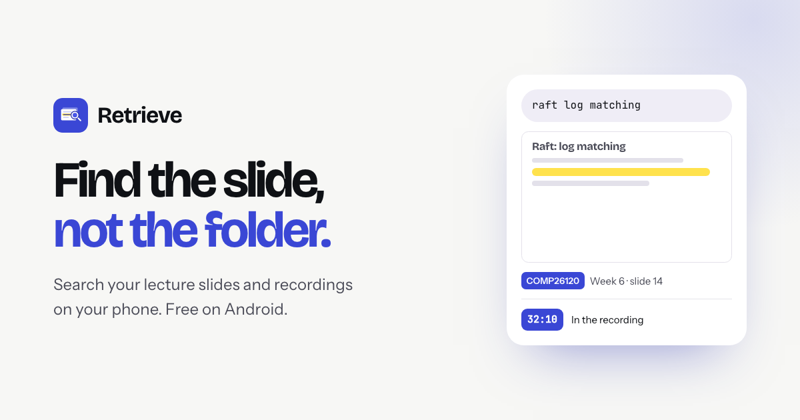
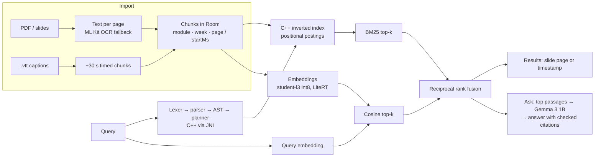

# Retrieve

**On-device lecture search for Android.** Retrieve makes a student's lecture slides, PDFs and
recording captions searchable on the phone. It has a C++ search engine with its own query language,
a PyTorch-distilled embedding model for search by meaning, timestamps into lecture recordings, and a
small on-device language model that answers questions with citations. Nothing leaves the device.

[Website](https://retrieve-cs9.pages.dev) · [Privacy policy](https://retrieve-cs9.pages.dev/privacy) ·
Google Play (in closed testing, waiting for approval) · Demo video (coming soon)



---

## Why

Revising means finding where something was taught: one slide in fourteen PDFs, or one minute in a
two-hour recording. Many slide decks are images, so Ctrl+F finds nothing, and phone search can't look
inside any of it. A student asks *"where did they explain Raft log matching?"* and Retrieve answers
**COMP26120 · Week 6 · slide 14**, and **32:10** in the recording.

## What it does

- **Import** PDFs and WebVTT caption files from the lecture portal, filed by module and week. Pages that are
  images are read with on-device OCR (ML Kit). Indexing runs as a foreground job with a progress
  notification ("Page 12 of 141"), so long, image-heavy PDFs aren't cut off by Android's background limits.
- **Search** with a C++ inverted index and BM25, called from Kotlin over JNI, fused with semantic
  search from a distilled, int8-quantised embedding model (reciprocal rank fusion). Matches found
  only by meaning are hidden below a similarity threshold, so a query the material doesn't cover returns
  nothing instead of ten unrelated slides.
- **Query language** for narrowing down: `module:COMP26120 week:4..6 "amortised" NOT tutorial`,
  parsed to an AST and run by a planner that applies filters first and orders terms by selectivity.
- **Recordings**: captions are merged into ~30-second chunks, so results open the transcript at the
  right timestamp.
- **See the slide**: results show the rendered page with the search words highlighted, plus a
  full-screen viewer and copyable citations.
- **Ask**: the key sentences from the two best passages come first, copied word for word, then
  Gemma 3 1B (LiteRT-LM) adds a short answer of at most two sentences. Every citation is checked
  against the passages it was given, and questions the material doesn't cover get
  "Not in your materials". The model arrives through Google Play the first time you open Ask, and the
  whole flow has been checked in airplane mode.

## How it works



| Layer | What's there |
| --- | --- |
| `app/` (Kotlin, Jetpack Compose) | UI, Room database, import and indexing on WorkManager, LiteRT embedding runner, LiteRT-LM answering, RRF fusion |
| `native/` (C++17, CMake) | Tokenizer, index builder and reader, BM25, query lexer/parser/planner/executor, JNI bridge, `retrieve_cli` for desktop benchmarks |
| `ml/` (Python, PyTorch) | Test set, teacher baseline, distillation, LiteRT export, int8 quantisation, one evaluation harness, refusal threshold, Q&A scoring |
| `web/` | The [landing page](https://retrieve-cs9.pages.dev) (static, Cloudflare Pages) |
| `docs/` | Spec, implementation plan, daily dev log, query-language reference, UI and website design records, `results/` |

## Results

Every number below comes from a CSV in [`docs/results/`](docs/results/), written by the script named
in its `script` column. [docs/results/README.md](docs/results/README.md) maps each headline number to
its exact row and the command that produced it. Laptop figures are from an Apple M1 (8 GB). On-device figures are from the
**development** device, a Galaxy Tab A7 (SM-T505N, Snapdragon 662, 3 GB). The final numbers will be
re-measured on a newer measurement phone; see [the device decision](docs/NOTES.md).

### Retrieval quality

121 held-out test questions (101 answered by a slide, 20 by a moment in a recording), all scored by the
same harness, [`ml/eval.py`](ml/eval.py). 95% confidence intervals come from 10,000 bootstrap resamples
([`recall.csv`](docs/results/recall.csv), [`recall_ci.csv`](docs/results/recall_ci.csv)).

| Method | Recall@5 (all, n = 121) | Slides (n = 101) | Recordings (n = 20) | MRR@10 |
| --- | --- | --- | --- | --- |
| BM25 (C++ engine) | 0.835 [0.769, 0.901] | 0.812 | 0.95 | 0.676 |
| Teacher, all-MiniLM-L6-v2 fp32 | 0.868 [0.810, 0.926] | 0.842 | 1.00 | 0.684 |
| Student-l3 int8 (LiteRT, shipped) | 0.826 [0.760, 0.893] | 0.802 | 0.95 | 0.649 |
| **Hybrid: BM25 + student int8 (RRF, k = 60)** | **0.868** [0.810, 0.926] | **0.861** | 0.90 | 0.683 |

The paired differences are not statistically significant at this sample size (hybrid − BM25:
+0.033 [−0.017, +0.083]). Quantisation cost nothing measurable (int8 − fp32 = 0.000).

The app hides meaning-only matches below the Ask refusal threshold (0.4768, tuned on dev). On the
same test set that moves hybrid recall@5 from 0.868 to 0.860 and recall@1 from 0.545 to 0.570, and
leaves dev unchanged ([`weak_filter.csv`](docs/results/weak_filter.csv)).

### Embedding model: distillation and quantisation

| Model | Parameters | Size | Laptop latency (median) | Tablet latency (median, CPU) |
| --- | --- | --- | --- | --- |
| Teacher, all-MiniLM-L6-v2 | 22.6 M | 90.1 MB | 10.99 ms | 269.9 ms |
| Student-l3 fp32 | 10.4 M (46%) | 42.0 MB | 5.76 ms | – |
| **Student-l3 int8** | 10.4 M | **11.2 MB** | – | **88.6 ms** (3.0× faster) |

The student keeps teacher layers 0, 3 and 5, a vocabulary pruned from 30,522 to 13,164 tokens, and
128 positions. It was distilled with a cosine loss on lecture text and WikiText-2, raising held-out
fidelity to the teacher from 0.558 to 0.915. LiteRT export matches PyTorch to a max abs difference of 1.7e-7 on 50
inputs, and int8 against fp32 gives cosine ≥ 0.999
([`embed_latency_*.csv`](docs/results/), [`quantize.csv`](docs/results/quantize.csv),
[`parity.csv`](docs/results/parity.csv), [`distill_student-l3.csv`](docs/results/distill_student-l3.csv)).
The GPU delegate failed to compile both models on the tablet, so all on-device numbers are CPU.

### Query planner

210 benchmark queries generated from the corpus with a fixed seed, each run 101 times through the
planner and through a naive left-to-right executor that filters after scoring
([`planner.csv`](docs/results/planner.csv)). The median query takes **8.9 µs planned vs 171 µs naive**,
about 21× faster. Filter queries gain least (median 7.3×) and boolean queries most (35×). Planned and
naive results are identical, bit for bit, on 1,000 random queries over the real vocabulary.

### Ask (question answering)

- **Refusal**: a similarity threshold tuned on the dev split only (0.477) answers 95.9% of answerable
  test questions and refuses 8 of 8 off-topic ones ([`refusal.csv`](docs/results/refusal.csv)).
- **Faithfulness** on 30 questions fixed before any answers were generated, judged answer by answer
  against the passages (correct, partly correct or correct refusal count as faithful):

  | Run | Faithful | Slides (20) | Recordings (5) | Off-topic refused (5) | First token (median, tablet) |
  | --- | --- | --- | --- | --- | --- |
  | v1: Gemma answers from 4 passages | 11 / 30 | 5 | 1 | 5 | 32.5 s |
  | **v2: key sentences first, Gemma ≤ 2 sentences, 2 passages** | **16 / 30** | 10 | 1 | 5 | 20.3 s |

  ([`qa_eval.csv`](docs/results/qa_eval.csv), [`qa_eval_v2.csv`](docs/results/qa_eval_v2.csv), scored by
  `ml/qa_report.py`.) v2 was designed after reading v1's answers, so it is a second run on the same 30
  questions, not a fresh held-out result. In v1, retrieval usually found the right passage and most
  failures were the 1B model misreading it, which is what v2 works around. In both runs no citation
  pointed outside the given passages and every off-topic question was refused.
- **Speed on the tablet**: 20.3 s to first token and 4.5 tokens/s for v2 (median of 24 answered
  questions). That's too slow on a 3 GB device, which is why measurement moves to a newer phone.

### Still to measure

These are waiting for the measurement phone. The scripts are ready:

| Measurement | Script | Output |
| --- | --- | --- |
| Search latency P50 / P90 / P99 (≥ 200 warm queries, airplane mode) | `scripts/search_latency.sh` | `search_latency.csv` |
| Battery, peak memory and index size per indexing / embedding run | `scripts/battery_run.sh` | `battery.csv` |
| Indexing resumes after a force-stop with no duplicate chunks (**passed** on the tablet: 181 of 181 chunks) | `scripts/resume_check.sh` | `resume_check.csv` |
| Ask speed and the 30-question run | `scripts/qa_eval.sh` | `ml/data/qa/runs/*.jsonl` |

## Query language

```
module:COMP21111 week:4..6 "unit propagation" NOT example
```

Plain words work like a normal search engine. `module:`, `week:` (single weeks or ranges) and
`type:slides|pdf|audio` filter; `"quotes"` match a phrase; `AND`, `OR`, `NOT` and parentheses
combine, with operators only in upper case. Errors report the position of the problem. The full grammar,
matching rules and planner design are in [docs/query-language.md](docs/query-language.md).

## Building and running

### Requirements

- Android Studio with NDK `30.0.16248370` and CMake ≥ 3.22. JDK 21 for Gradle (the app targets Java 17).
- An arm64 Android device or emulator, Android 10+ (minSdk 29).
- For the desktop C++ tests: CMake and a C++17 compiler. GoogleTest is fetched by CMake.
- For the ML pipeline: Python 3.11 and `pip install -r ml/requirements.txt`.

### The app

```sh
./gradlew assembleDebug            # builds the app and the native library through the NDK
./gradlew installDebug             # installs com.mideyy7.retrieve.debug on the connected device
./gradlew testDebugUnitTest        # JVM unit tests and Robolectric UI tests
scripts/device-tests.sh            # instrumented tests (doesn't uninstall the app, so your library survives)
```

The models are build outputs and not committed (`models/` is gitignored):

- **Embedding model**: run the ML pipeline below, then
  `python ml/tools/install_app_model.py --name student-l3 --file model_int8.tflite`. It copies the
  model into `app/src/main/assets/embedding/` and records its SHA-256 in `model.json`. The app
  re-embeds everything if that hash changes.
- **Answering model** (Gemma 3 1B int4, `.litertlm`, 584 MB): release bundles ship it in
  `gemma_pack`, an on-demand Play AI pack, so the base download stays at **38.7 MB** and Search never
  needs it. The app verifies the pack's SHA-256 before loading it. Run `scripts/install_llm_pack.sh`
  before `./gradlew bundleRelease`. During development `scripts/push_llm.sh` copies the model to the
  debug app instead. Gemma is gated on Hugging Face, so accept its licence first.

### The C++ engine on the desktop

```sh
cmake -S native -B native/build && cmake --build native/build && ctest --test-dir native/build
cmake -S native -B native/build-release -DCMAKE_BUILD_TYPE=Release && cmake --build native/build-release
python3 scripts/planner_bench.py --runs 101      # planner vs naive → docs/results/planner.csv
```

The tests cover the tokenizer, index, BM25 against hand-computed scores, the parser on valid and invalid
input, and planned-vs-naive equivalence. They also pass under AddressSanitizer and UBSan.

### The ML pipeline

```sh
python ml/baseline.py --model teacher                                       # teacher params, latency
python ml/distill.py --name student-l3 --layers 0,3,5                        # train the student
python ml/export_litert.py --model ml/checkpoints/student-l3 --name student-l3   # + parity check
python ml/quantize.py --name student-l3                                      # int8
python ml/eval.py --method hybrid --model models/student-l3/model_int8.tflite --split test
python ml/significance.py                                                    # bootstrap CIs
python -m pytest ml/tests
```

**The lecture corpus isn't in the repo** because the slides are the university's copyright. The questions
and their labels ([`ml/data/questions.json`](ml/data/questions.json)) are. Labels point at a document
SHA-256 and page, or a time range, so the evaluation reproduces against the same files. To run it on
your own material, import it in the app and use **Library → Export chunks** to produce
`ml/data/chunks.json`. The test split is frozen, and its hash is recorded in [docs/NOTES.md](docs/NOTES.md).

## Design decisions

- **On-device only, enforced by the OS.** No account, no server, no analytics, and no network
  permission at all. The `INTERNET` and `ACCESS_NETWORK_STATE` permissions that ML Kit pulls in for
  telemetry are removed in the manifest (`tools:node="remove"`). The Ask model arrives through Google
  Play, not the app. See the [privacy policy](https://retrieve-cs9.pages.dev/privacy).
- **Captions, not audio.** Students already have caption files from the lecture portal. They import in
  seconds and cost no battery. On-device Whisper was prototyped (real-time factor 0.42 tiny / 0.79
  base on the tablet) and deliberately not shipped.
- **One evaluation harness for every method**, a frozen test split, and thresholds tuned on dev only.
  Results are reported with confidence intervals, and gains aren't claimed where they aren't
  significant.
- **Development device vs measurement device.** The 3 GB tablet is used to build and check correctness.
  Every published on-device number will come from one named measurement phone.

## Documentation

| Doc | What's in it |
| --- | --- |
| [docs/plan.md](docs/plan.md) | Project spec: goals, architecture, component specs, measurement method |
| [docs/IMPLEMENTATION_PLAN.md](docs/IMPLEMENTATION_PLAN.md) | Phases with exit gates, and the Play release track |
| [docs/NOTES.md](docs/NOTES.md) | Daily dev log: decisions, measurements, bugs found |
| [docs/results/README.md](docs/results/README.md) | Every headline number → CSV row → command |
| [docs/query-language.md](docs/query-language.md) | Grammar and matching semantics |
| [docs/ui.md](docs/ui.md) | Library and search UI design record |
| [docs/web.md](docs/web.md), [scripts/web/README.md](scripts/web/README.md) | Website design, deployment and launch checklist |

## Credits

- Teacher model: [sentence-transformers/all-MiniLM-L6-v2](https://huggingface.co/sentence-transformers/all-MiniLM-L6-v2) (Apache 2.0).
- Answering model: Gemma 3 1B, under the Gemma terms of use.
- [LiteRT](https://ai.google.dev/edge/litert) and LiteRT-LM, [ML Kit text recognition](https://developers.google.com/ml-kit/vision/text-recognition/v2), [PdfBox-Android](https://github.com/TomRoush/PdfBox-Android) (Apache 2.0), [GoogleTest](https://github.com/google/googletest).

Built by Ayo, a Computer Science student at the University of Manchester.
